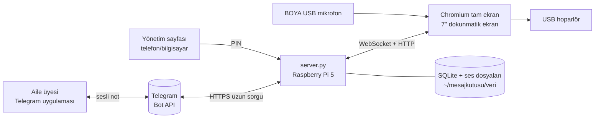

# Raspberry Time · Sesli Mesaj Kutusu

Küçük çocukların aile büyükleriyle **sesli mesajlaşabildiği**, ekranlı bir masa cihazı.
[button.box](https://button.box)'tan esinlenildi; düğme yerine 7" dokunmatik ekran, WhatsApp yerine **Telegram botu** kullanır.

- Çocuk ekranda kişinin fotoğrafına dokunur, mikrofona dokunup konuşur, tekrar dokunur: mesaj kişinin Telegram'ına sesli not olarak gider.
- Aile üyeleri Telegram'dan normal sesli mesaj gönderir; kutuda zil çalar, kişinin kutucuğu parlar, çocuk dinle düğmesine basar.
- Okuma yazma gerekmez: ekranda yalnızca fotoğraflar ve iki büyük düğme (dinle / konuş) vardır.
- SIM kart, telefon hattı ya da uygulama gerekmez. Sadece onayladığın kişiler kutuya ulaşabilir.

## Depo yapısı

| Klasör | İçerik |
|---|---|
| [`donanim/`](donanim/) | Parça listesi, 3D baskı dosyaları (STL), parametrik kasa modeli (`kasa.py`), adım adım montaj |
| [`yazilim/`](yazilim/) | Kutunun yazılımı (`mesajkutusu/`), kurulum, Telegram botu, uzaktan güncelleme, sorun giderme |

## Baştan sona yol haritası

| # | Adım | Rehber |
|---|---|---|
| 1 | Parçaları topla | [donanim › 1. Parça listesi](donanim/README.md#1-parça-listesi) |
| 2 | Kasayı bas (önce küçük deneme parçası) | [donanim › 2. 3D baskı](donanim/README.md#2-3d-baskı) |
| 3 | Telegram botunu oluştur | [yazilim › 1. Telegram botu](yazilim/README.md#1-telegram-botunu-oluştur) |
| 4 | SD kartı yaz ve hazırla | [yazilim › 2–3](yazilim/README.md#2-sd-kartı-yaz-raspberry-pi-imager) |
| 5 | Elektroniği ve kasayı birleştir | [donanim › 3. Montaj](donanim/README.md#3-montaj-adım-adım) |
| 6 | İlk açılış, ekran yönü, ses | [yazilim › 4–6](yazilim/README.md#4-kartı-tak-ve-aç) |
| 7 | Kendini ve aileyi ekle | [yazilim › 7–8](yazilim/README.md#7-yönetim-sayfası-ve-ilk-kişi) |
| 8 | Uzaktan bakım ve güncelleme | [yazilim › 9](yazilim/README.md#9-uzaktan-erişim-ve-güncelleme) |

## Nasıl çalışır

- Pi'de tek bir Python sunucusu (`aiohttp`) çalışır; Telegram'ı dinler, ses dosyalarını `ffmpeg` ile Opus'a çevirir, kişileri ve mesajları SQLite'ta tutar.
- Ekran, aynı sunucudan açılan bir web sayfasıdır (Chromium kiosk modu). Kayıt tarayıcıda yapılır, sunucuya yüklenir, Telegram'a gönderilir.
- Yönetim sayfası ev ağındaki herhangi bir cihazdan PIN ile açılır: kişi onaylama, fotoğraf, renk, sıra, deneme mesajı.

## Gizlilik

- Bot yalnızca yönetim sayfasında **onayladığın** kişilerin mesajlarını kabul eder; gruplar ve tanımadığı kişiler yok sayılır.
- Bot anahtarı ve PIN yalnızca cihazdaki `ayarlar.env` dosyasında durur, bu depoya girmez (`.gitignore`).
- Mesajlar ve fotoğraflar cihazda (`~/mesajkutusu/veri`) saklanır; kişi başına son 40 mesaj tutulur.
