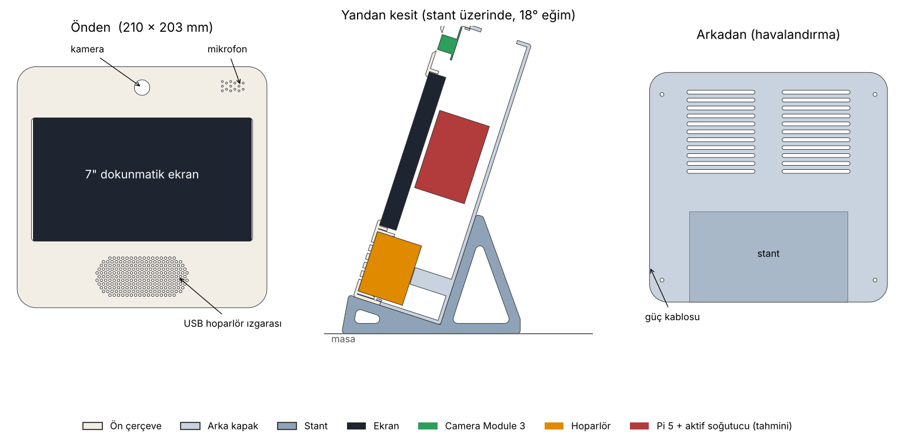
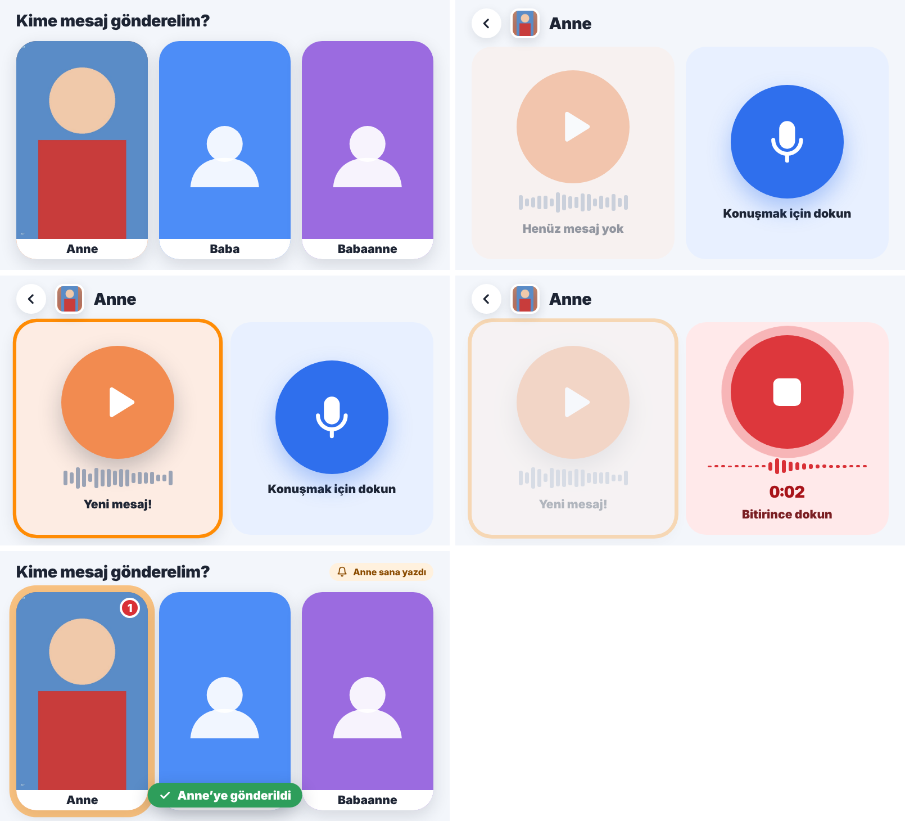
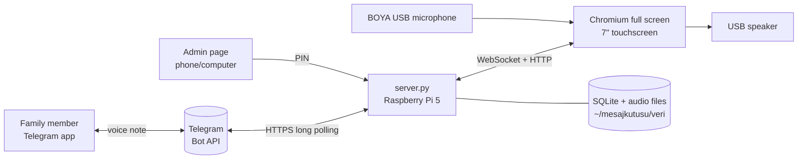

# Raspberry Time · Voice Message Box

A desk device with a screen that lets young children **exchange voice messages** with their family.
Inspired by [button.box](https://button.box); it uses a 7" touchscreen instead of physical buttons and a **Telegram bot** instead of WhatsApp.

- The child taps a person's photo, taps the microphone, talks, and taps again: the message arrives in that person's Telegram as a voice note.
- Family members send ordinary Telegram voice messages; the box chimes, the person's tile glows, and the child presses play.
- No reading or writing needed: the screen only shows photos and two big buttons (listen / talk).
- No SIM card, phone line or app required. Only people you approve can reach the box.

> The device interface and the admin page are in Turkish by default; the child's screen and the bot messages can be switched to English from the admin page (**Genel › Dil**).

## Repository layout

| Folder | Contents |
|---|---|
| [`donanim/`](donanim/) (hardware) | Parts list, 3D-print files (STL), parametric case model (`kasa.py`), step-by-step assembly |
| [`yazilim/`](yazilim/) (software) | The box software (`mesajkutusu/`), installation, Telegram bot, remote updates, troubleshooting |

## Roadmap from start to finish

| # | Step | Guide |
|---|---|---|
| 1 | Gather the parts | [hardware › 1. Parts list](donanim/README.md#1-parts-list) |
| 2 | Print the case (small test piece first) | [hardware › 2. 3D printing](donanim/README.md#2-3d-printing) |
| 3 | Create the Telegram bot | [software › 1. Telegram bot](yazilim/README.md#1-create-the-telegram-bot) |
| 4 | Write and prepare the SD card | [software › 2–3](yazilim/README.md#2-write-the-sd-card-raspberry-pi-imager) |
| 5 | Assemble the electronics and the case (glue the screen in, tape the cables) | [hardware › 3. Assembly](donanim/README.md#3-step-by-step-assembly) · [3.9 Cable management](donanim/README.md#39-cable-management) |
| 6 | First boot, screen orientation, audio | [software › 4–6](yazilim/README.md#4-insert-the-card-and-power-on) |
| 7 | Add yourself and the family | [software › 7–8](yazilim/README.md#7-admin-page-and-first-contact) |
| 8 | Remote maintenance and updates | [software › 9](yazilim/README.md#9-remote-access-and-updates) |

## How it works

- A single Python server (`aiohttp`) runs on the Pi. It listens to Telegram, converts audio to Opus with `ffmpeg`, and keeps contacts and messages in SQLite.
- The screen is a web page served by the same server (Chromium kiosk mode). Recording happens in the browser; the clip is uploaded to the server and sent to Telegram.
- The admin page opens from any device on the home network with a PIN: approve contacts, photos, colors, order, sound, screen, quiet hours, updates and more.

## Privacy

- The bot only accepts messages from people you **approve** on the admin page; groups and strangers are ignored.
- The bot token and PIN live only on the device (`ayarlar.env` and the local database) and never enter this repository (`.gitignore`).
- Messages and photos are stored on the device (`~/mesajkutusu/veri`); by default the last 40 messages per person are kept.
