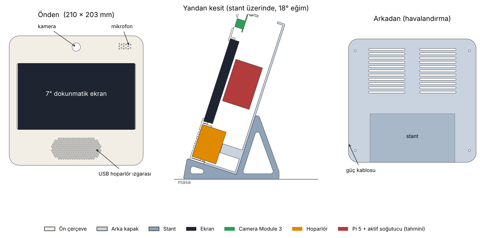
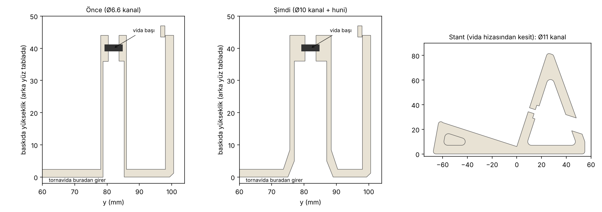

# Hardware

Device: **210 × 203 × 63 mm**, sitting on its own stand tilted back by 18°.
The case is three printed parts: front frame, back cover and stand. No soldering required.



---

## 1. Parts list

### Electronics

| Part | Qty | Notes |
|---|---|---|
| Raspberry Pi 5 (4 GB or 8 GB) | 1 | |
| Raspberry Pi 5 Active Cooler | 1 | Needed with the case closed |
| Raspberry Pi 27 W USB-C power supply | 1 | Official supply recommended; low power causes USB device problems |
| microSD card, 32 GB or larger (A1/A2) | 1 | |
| **Original** Raspberry Pi 7" Touch Display (800×480) | 1 | The case is drawn for this display (192.96 × 110.76 mm). Touch Display 2 does **not** fit |
| 22-pin → 15-pin display cable (for Pi 5) | 1 | Included in newer display boxes; wide end to the display, narrow end to the Pi |
| Raspberry Pi Camera Module 3 (standard) | 1 | Not used by the software yet; reserved for future video features |
| Pi 5 camera cable (22-pin → 15-pin) | 1 | |
| USB stereo speaker, **84 × 43 × 32 mm** pill-shaped (Adafruit 3369 type) | 1 | Sold in Turkey at Robotistan as "USB stereo hoparlör" |
| BOYA BY-M100UA USB-A microphone | 1 | Mini microphone with a hinge; **keep the foam windscreen on** |
| USB-A extension cable, male-female, 20–25 cm | 1 | Brings the microphone to the Pi |

> There is room for a Raspberry Pi AI HAT+ 2 behind the display (~43 mm), but it is not used in this project. It clashes with the display's mounting screws, so it is left off for now.

### Small parts

| Part | Qty | Used for |
|---|---|---|
| M3 × 20 screw | 4 | Fixes the back cover to the front frame. Self-tapping into plastic, no nut needed |
| M3 × 12 screw | 2 | Fixes the stand to the back cover (optional) |
| M2 × 6 screw | 4 | Fixes the camera to the front frame |
| Glue pen (or hot glue) | 1 | Fixes the screen to the frame (instead of foam tape) |
| Paper / electrical tape | a little | Secures ribbon cables and USB joints ([3.9](#39-cable-management)) |
| Small cable ties | 4–5 | Bundling the speaker cable, strain relief on the power cable, USB plugs |
| 1–2 mm double-sided foam tape | optional | On the support columns if the screen is not glued |
| Self-adhesive rubber feet | 4 | Under the stand |

---

## 2. 3D printing

Files: [`stl/`](stl/)

| File | Size (mm) | Face on the bed | Notes |
|---|---|---|---|
| `deneme_parcasi.stl` (test piece) | 94 × 85 × 32 | Front face | **Print this first.** Three small pieces: camera window, microphone cup and speaker cradle (~24 cm³) |
| `on_cerceve.stl` (front frame) | 210 × 203 × 32 | Front face | Screen pocket, camera, microphone cup and speaker cradle are in this part |
| `arka_kapak.stl` (back cover) | 210 × 203 × 47 | Back face | Vents, power cable hole, support columns, Ø10 screw channels (v8) |
| `stant.stl` (stand) | 123 × 82 × 140 | Side profile | The STL is already oriented correctly |

**Slicer settings** (tested with Bambu Studio and a Bambu Lab H2D; the same logic applies to other printers):

1. Filament: PLA (Bambu PLA Basic).
2. Layer height 0.2 mm, 3 walls, 15% infill.
3. **No supports needed.** All overhangs are kept under 45°.
4. "Avoid crossing walls" on (prevents stringing on the stand).
5. Place the STLs on the bed as they are, without rotating them.

**Print order:**

1. Print `deneme_parcasi.stl`. Screw the camera onto its piece with 4 × M2 screws and check that the lens is centered in the hole. Press the microphone (with its foam) into the cup and the speaker into its cradle.
   - Microphone too hard to insert: set `CUP_OPEN = 16.0` in `kasa.py`
   - Microphone too loose: `CUP_BORE = 17.0`
   - Speaker too tight: `SPK_CLR = 0.5` (or lightly shave the ribs with a craft knife)
   - If you changed anything, regenerate the STLs as in [section 5](#5-modifying-the-design) and reprint the test piece.
2. If the test piece fits well, print `on_cerceve.stl`.
3. `arka_kapak.stl`.
4. `stant.stl`.


---

## 3. Step-by-step assembly

> Prepare the SD card before assembly: [software guide, steps 1–3](../yazilim/README.md). Reaching the card is a hassle once the case is closed.

### 3.1 Mount the Pi on the display

1. Fit the Active Cooler to the Pi 5 (adhesive pads + two push pins, fan cable into the Pi's **FAN** header).
2. Insert the SD card into the Pi.
3. Lay the display glass-down on a soft cloth.
4. Screw the Pi onto the 4 standoffs on the back of the display using the screws that came with the display.

### 3.2 Display cable

1. Gently lift the plastic latch of the cable connector on the display's adapter board and on the Pi 5.
2. Plug the **wide (15-pin)** end of the 22→15 cable into the display adapter board and the **narrow (22-pin)** end into one of the two **CAM/DISP** ports on the Pi 5.
3. Push the cable all the way in and close the latch. The cable's metal contacts must face the contacts in the connector; if inserted the wrong way round the screen stays dark but nothing is damaged.
   Details: [Raspberry Pi Touch Display documentation](https://www.raspberrypi.com/documentation/accessories/display.html)

### 3.3 Display power (no soldering)

Use the two colored jumper wires that come with the display:

| Display adapter board | Pi 5 GPIO | Wire |
|---|---|---|
| **5V** | **Pin 4** (5V) | red |
| **GND** | **Pin 6** (GND) | black |

Pin 1 is the pin at the end of the GPIO header closest to the SD card; pins 2 and 4 are on the row facing the board edge.

### 3.4 Camera

1. Plug the wide end of the camera cable into the Camera Module 3 and the narrow end into the **remaining** CAM/DISP port on the Pi 5.
2. Screw the camera onto the 4 standoffs in the top band of the front frame with 4 × M2 × 6 screws, lens facing the window and the cable coming out **downwards**.
3. Route the cable through the notch in the top wall of the screen pocket to the back of the display.


### 3.5 Place the screen in the frame

1. Lay the front frame face down (front face on the table).
2. Place the display glass-down into the pocket. There is 0.5 mm of clearance on every side; it should drop in without force.
3. Check that the cables pass freely through the notches in the pocket wall. If the picture is upside down at first boot, that's fine; it can be rotated in software ([software › 4](../yazilim/README.md#4-screen-orientation)); the setup screen has an "Ekran ters mi?" (Screen upside down?) button.
4. **Fix the screen with a glue pen** (instead of foam tape; the foam doesn't stay in place):
   1. Seat the display in its final position and check from the front that the active area is centered in the frame window.
   2. Apply glue in the corner between the **outer edge of the display's metal back frame** and the **inner face of the pocket wall**: 2 dots on each long side and 1 on each short side (6 in total), each 1–2 cm long.
   3. **Don't** put glue on the edge of the glass, the active area, the adapter board on the back, or the ribbon cables.
   4. Leave the front frame face down while the glue sets (see the glue's packaging, usually a few minutes); you can place a light weight on the display.
   5. If you ever need to remove the screen, just cut the dots with a craft knife; that's why you use dots rather than a continuous bead.

### 3.6 Speaker

1. Press the speaker straight into the pill-shaped cradle in the bottom band, sound side facing the grille. The thin ribs inside hold it firmly.
2. Bundle the excess cable with a cable tie and plug the USB into the Pi.

### 3.7 Microphone


1. **Don't remove the foam.** The cup is designed around the foam-covered head; the foam provides both the grip and the sound path.
2. Open the microphone straight at its hinge and plug the female end of the USB extension onto the microphone's plug.
3. With the front frame face down, place the foam-covered head on the cup with its tip pointing **right** (the top-right corner when viewed from the front).
4. Push the tip against the right wall of the cup and press with your thumb: the foam squeezes through the opening and expands inside.
5. Route the extension cable behind the camera and plug it into a free USB port on the Pi.

### 3.8 Close the case

1. If you glued the screen, the back cover's 4 support columns are only a safety backup and need no foam. If you didn't, stick 1–2 layers of foam tape on the column tips.
2. The ribs in the cradle hold the speaker; the column on the back cover supports it from behind as well (foam optional).
3. Pass the power cable through the hole in the right side of the back cover and plug it into the Pi.
4. Close the back cover with 4 × M3 × 20 screws. Drop each screw into its corner hole on the back face and lower the screwdriver down the Ø10 channel: the screw head seats at the bottom of the channel, about 36 mm below the back face. The screws tap their own threads in the plastic; tighten firmly but without forcing. A medium Phillips (PH1/PH2) or hex screwdriver with a shaft of at least 50 mm is enough.
5. Set the device on the stand; optionally fix it with 2 × M3 × 12 screws: insert each screw through the Ø11 channel at the back of the stand and drive it along the channel. Stick the rubber feet under the stand.



### 3.9 Cable management

Cables can get pulled out while the case is being closed or the device is moved. Before closing the cover:

| Cable | Problem | Fix |
|---|---|---|
| Display ribbon cable (22→15) | If a latch isn't fully closed or the cable is under tension, contact is lost and the screen goes dark | Close the connector latches fully at both ends. Fold the cable once gently (no sharp creases) and tape the fold to the display's metal back with paper or electrical tape. |
| Camera ribbon cable | Gets pulled out of its connector as the cover closes | Close the latches; after routing the cable through the notch, tape it to the back of the display. Leave the excess as a loose loop next to the Pi. |
| Display power (pin 4 / pin 6 jumper wires) | Dupont plugs slip off easily with vibration → the screen turns off | Twist the two wires together lightly. Put a small dot of glue-pen glue at the base of the two plugs on the Pi side, or wrap both plugs together with one turn of tape (don't let glue run onto the pins). |
| Microphone ↔ USB extension joint | The plug comes out of the extension's socket → "Mikrofon bulunamadı" (microphone not found) | Wrap the joint with a turn or two of electrical tape. Route the extension behind the camera and tape it to the back of the display. |
| USB speaker cable (1.2 m) | Excess cable pushes on the cover and pulls the plug out of the Pi | Bundle the excess into an 8–10 cm loop with a cable tie and tape the bundle to the back of the display; leave some slack between the plug and the bundle. |
| Power cable | Pulling from outside yanks the USB-C plug out of the Pi | After feeding the cable through the side hole, put a cable tie on it about 3 cm inside the hole (strain relief): when pulled from outside, the tie catches on the hole and the plug isn't stressed. |
| USB plugs | Work half-way out of the Pi's USB ports | Push the plugs all the way in; tie the two cables together with a cable tie just in front of the Pi's USB ports. |

**Final check before closing:** Power on the Pi, check that the screen comes on, that the speaker and microphone appear on the admin page's **Ses** (Sound) tab, and that **Zili kutuda çal** (Ring the chime on the box) plays a sound; then close the cover and test once more.

### Connection summary

| Pi 5 port | Connected to |
|---|---|
| CAM/DISP 0 or 1 | Display (22→15 cable) |
| Other CAM/DISP | Camera Module 3 |
| GPIO pin 4 / pin 6 | Display power 5V / GND |
| USB | USB speaker |
| USB | BOYA microphone (via extension) |
| FAN | Active Cooler |
| USB-C | 27 W power supply |

---

## 4. Dimension sources and design notes

- **Display:** Original Raspberry Pi 7" Touch Display, official size 192.96 × 110.76 mm, active area 154.08 × 85.92 mm. The pocket has 0.5 mm clearance on every side (for PLA shrinkage). The front lip overlaps the glass by 4 mm without covering the picture.
- **Camera Module 3** ([official mechanical drawing](https://pip-assets.raspberrypi.com/categories/1207-design-files/documents/RP-008153-DS-1-camera-module-3-standard-mechanical-drawing.pdf)): board 25 × 23.862 mm, Ø2.2 holes 2 mm from the edges (21 × 12.5 mm spacing). The lens center is 14.4 mm from the **top edge**, i.e. level with the lower pair of screws. The window opens from Ø13 to Ø18 and doesn't clip the 66° × 41° field of view.
- **Speaker:** 84 × 43 × 32 mm with semicircular ends. The cradle is pill-shaped too, with 0.3 mm clearance and 12 mm walls. The 8 ribs inside squeeze it by 0.2 mm.
- **Microphone (BOYA BY-M100UA):** Official size Ø18 × 75 mm including the foam. The head without foam is about Ø14–15. The cup has a 17.6 mm bore and a 15 mm opening at the back (wraps ~243°). Sound reaches the head through a channel from the 15 holes on the front. The rubber ring behind the head stays outside the cup.
- **Heat:** Two rows of vent slots in the upper part of the back cover; with the Active Cooler the Pi runs comfortably inside the case.

---

## 5. Modifying the design

The case is fully parametric: [`kasa/kasa.py`](kasa/kasa.py) (Python, `manifold3d` + `trimesh`).

```bash
pip install manifold3d trimesh numpy matplotlib
cd donanim/kasa
python3 kasa.py        # writes 4 STLs to the stl/ folder and prints sizes and volumes
python3 onizleme.py    # gorseller/kasa_onizleme.png
```

Frequently changed values:

| Variable | Meaning |
|---|---|
| `EW`, `EH`, `E_CLR` | Display size and pocket clearance |
| `CAM_LENS_Y`, `CAM_WIN_D`, `CAM_STANDOFF` | Camera window position/diameter, camera standoff height |
| `CUP_BORE`, `CUP_OPEN`, `CUP_X0` | Microphone cup bore, opening width, start position |
| `SPK_W`, `SPK_H`, `SPK_D`, `SPK_CLR`, `SPK_WALL_TOP` | Speaker size, clearance, cradle wall height |
| `SCREW_BORE`, `STAND_BORE` | Screwdriver channel diameters in the back cover and the stand |
| `THETA` | Stand angle (degrees) |
| `SHELL_D` | Back cover depth |

The back cover and stand are not affected by changes to the front frame; as long as `W`/`H` (outer size) stay the same, they don't need reprinting.

---

## 6. Version history

- **v8** – Screwdriver access: back cover screw channels Ø6.6 → Ø10 with an entry funnel on the back face; stand screw channels Ø6.8 → Ø11 (teardrop-shaped for printing). Front frame unchanged. The screen can be glued instead of using foam.
- **v7** – Instead of the microphone clamp, a snap-in cup from the back that wraps the foam-covered head. Pill-shaped speaker cradle with 12 mm walls and crush ribs. Test piece.
- **v6** – Camera window moved 4.9 mm down (lens center measured from the top edge), Ø13.
- **v5** – Front frame redrawn for the original 7" Touch Display (earlier versions were for Touch Display 2).
- **v4** – Microphone moved from the top face to the front face.
- **v3** – USB speaker + USB microphone instead of a sound card; bottom band enlarged.
- **v2** – Stand as a single solid profile (the ribs in v1 caused stringing).
