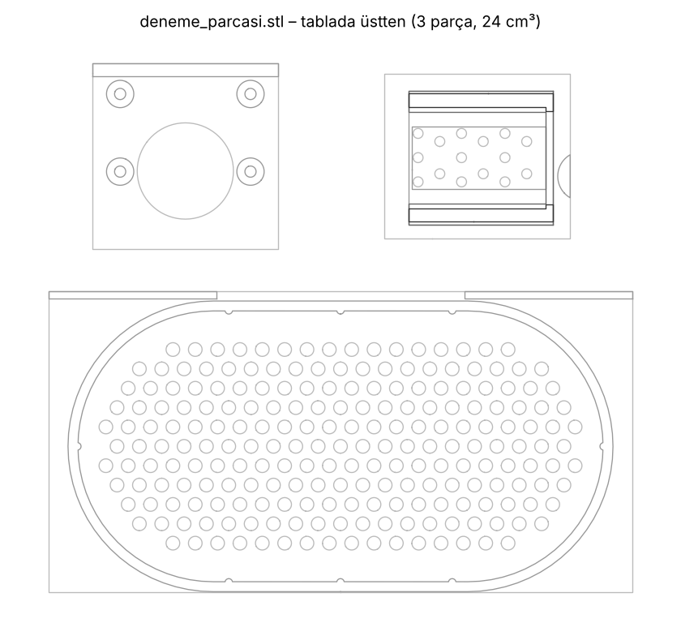
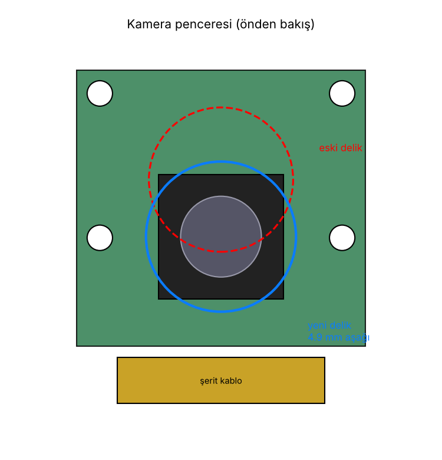
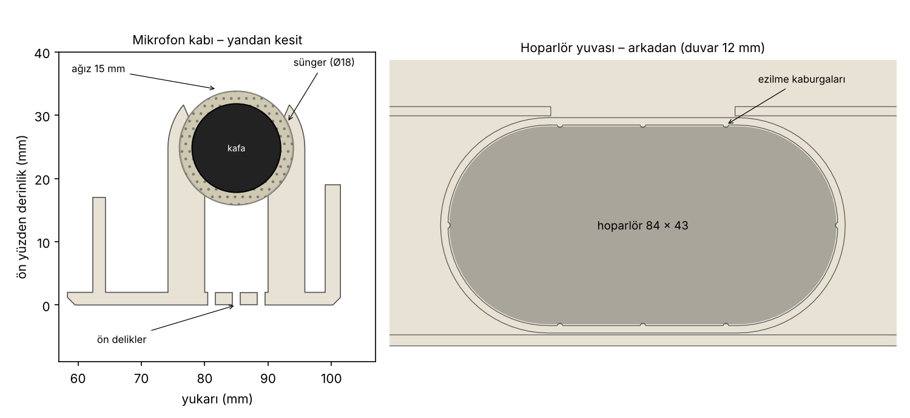

# Donanım

Cihaz: **210 × 203 × 63 mm**, kendi standı üzerinde 18° geriye eğik durur.
Kasa üç baskı parçasından oluşur: ön çerçeve, arka kapak, stant. Lehim gerekmez.


---

## 1. Parça listesi

### Elektronik

| Parça | Adet | Not |
|---|---|---|
| Raspberry Pi 5 (4 GB veya 8 GB) | 1 | |
| Raspberry Pi 5 Aktif Soğutucu (Active Cooler) | 1 | Kasa kapalıyken gerekli |
| Raspberry Pi 27 W USB-C güç adaptörü | 1 | Resmi adaptör önerilir; düşük güçte USB cihazlar sorun çıkarır |
| microSD kart, 32 GB veya üstü (A1/A2) | 1 | |
| **İlk** Raspberry Pi 7" Touch Display (800×480) | 1 | Kasa bu ekrana göre çizildi (192.96 × 110.76 mm). Touch Display 2 **uymaz** |
| 22-pin → 15-pin ekran kablosu (Pi 5 için) | 1 | Yeni ekran kutularından çıkar; geniş ucu ekrana, dar ucu Pi'ye |
| Raspberry Pi Camera Module 3 (standart) | 1 | Şimdilik yazılımda kullanılmıyor, ileride görüntülü özellikler için |
| Pi 5 kamera kablosu (22-pin → 15-pin) | 1 | |
| USB stereo hoparlör, **84 × 43 × 32 mm** hap biçimli (Adafruit 3369 tipi) | 1 | Türkiye'de Robotistan'da "USB stereo hoparlör" olarak satılıyor |
| BOYA BY-M100UA USB-A mikrofon | 1 | Menteşeli mini mikrofon; **süngeri takılı kalır** |
| USB-A uzatma kablosu, erkek-dişi, 20–25 cm | 1 | Mikrofonu Pi'ye ulaştırmak için |

> Raspberry Pi AI HAT+ 2 kasaya sığacak şekilde yer bırakıldı (ekran arkasında ~43 mm), ama bu projede kullanılmıyor. Ekranın montaj vidalarıyla çakıştığı için şimdilik takılmıyor.

### Küçük malzeme

| Parça | Adet | Ne için |
|---|---|---|
| M3 × 20 vida | 4 | Arka kapağı ön çerçeveye bağlar. Plastiğe kendi diş açar, somun gerekmez |
| M3 × 12 vida | 2 | Standı arka kapağa bağlar (isteğe bağlı) |
| M2 × 6 vida | 4 | Kamerayı ön çerçeveye bağlar |
| Yapıştırıcı kalem (ya da sıcak silikon) | 1 | Ekranı çerçeveye sabitlemek için (köpük bant yerine) |
| Kâğıt bant / izole bant | biraz | Şerit kabloları ve USB birleşimlerini sabitlemek için ([3.9](#39-kablo-düzeni-kablolar-yerinden-çıkmasın)) |
| Küçük kablo bağı | 4–5 | Hoparlör kablosunu toplamak, güç kablosunda gerilme önleyici, USB fişleri |
| 1–2 mm köpük çift taraflı bant | isteğe bağlı | Ekran yapıştırılmadıysa dayama kolonlarının uçlarına |
| Yapışkanlı kauçuk ayak | 4 | Stantın altına |

---

## 2. 3D baskı

Dosyalar: [`stl/`](stl/)

| Dosya | Ölçü (mm) | Tablaya hangi yüz | Not |
|---|---|---|---|
| `deneme_parcasi.stl` | 94 × 85 × 32 | Ön yüz | **İlk bunu bas.** Kamera penceresi, mikrofon kabı ve hoparlör yuvasından 3 küçük parça (~24 cm³) |
| `on_cerceve.stl` | 210 × 203 × 32 | Ön yüz | Ekran yuvası, kamera, mikrofon kabı, hoparlör yuvası bu parçada |
| `arka_kapak.stl` | 210 × 203 × 47 | Arka yüz | Havalandırma, güç kablosu deliği, dayama kolonları, Ø10 vida kanalları (v8) |
| `stant.stl` | 123 × 82 × 140 | Yan profil yüzü | STL zaten doğru yönde |

**Dilimleyici ayarları** (Bambu Studio + Bambu Lab H2D ile denendi, diğer yazıcılarda da aynı mantık):

1. Filament: PLA (Bambu PLA Basic).
2. Katman yüksekliği 0.2 mm, 3 duvar, %15 doluluk.
3. **Destek gerekmez.** Tüm sarkmalar 45°'nin altında tutuldu.
4. "Avoid crossing walls" açık (stantta iplik kalmasını önler).
5. STL'leri döndürmeden olduğu gibi tablaya koy.

**Baskı sırası:**

1. `deneme_parcasi.stl` bas. Kamerayı 4 × M2 vidayla parçasına bağla ve lensin deliğin ortasında olduğunu gör. Süngerli mikrofonu kaba, hoparlörü yuvaya bastır.
   - Mikrofon çok zor giriyorsa: `kasa.py` içinde `CUP_OPEN = 16.0`
   - Mikrofon bol geliyorsa: `CUP_BORE = 17.0`
   - Hoparlör çok sıkıysa: `SPK_CLR = 0.5` (ya da kaburgaları maket bıçağıyla hafifçe kazı)
   - Değiştirdiysen [5. bölümdeki](#5-tasarımı-değiştirmek) gibi STL'leri yeniden üret ve deneme parçasını tekrar bas.
2. Deneme parçası iyi oturuyorsa `on_cerceve.stl`.
3. `arka_kapak.stl`.
4. `stant.stl`.



---

## 3. Montaj adım adım

> Montajdan önce SD kartı hazırla: [yazılım rehberi, 1–3. adımlar](../yazilim/README.md). Kasa kapandıktan sonra karta erişmek zahmetli.

### 3.1 Pi'yi ekrana bağla

1. Pi 5'e Aktif Soğutucu'yu tak (yapışkanlı ped + iki itme pimi, fan kablosu Pi'deki **FAN** girişine).
2. SD kartı Pi'ye tak.
3. Ekranı camı aşağı bakacak şekilde yumuşak bir bezin üzerine koy.
4. Pi'yi ekranın arkasındaki 4 aralayıcıya, ekranla gelen vidalarla bağla.

### 3.2 Ekran kablosu

1. Ekranın arkasındaki adaptör kartında ve Pi 5'te kablo konnektörünün plastik kilidini hafifçe yukarı kaldır.
2. 22→15 kablonun **geniş (15-pin)** ucunu ekran adaptör kartına, **dar (22-pin)** ucunu Pi 5'teki iki **CAM/DISP** girişinden birine tak.
3. Kabloyu sonuna kadar it, kilidi kapat. Kablonun metal temas yüzleri konnektördeki temaslara bakmalı; ters takılırsa ekran açılmaz ama zarar görmez.
   Ayrıntı: [Raspberry Pi Touch Display belgesi](https://www.raspberrypi.com/documentation/accessories/display.html)

### 3.3 Ekran beslemesi (lehimsiz)

Ekranla gelen iki renkli atlama kablosunu kullan:

| Ekran adaptör kartı | Pi 5 GPIO | Kablo |
|---|---|---|
| **5V** | **Pin 4** (5V) | kırmızı |
| **GND** | **Pin 6** (GND) | siyah |

Pin 1, GPIO başlığında SD karta en yakın köşedeki pindir; pin 2 ve 4 kartın kenarına bakan sıradadır.

### 3.4 Kamera

1. Kamera kablosunun geniş ucunu Camera Module 3'e, dar ucunu Pi 5'teki **boş kalan** CAM/DISP girişine tak.
2. Kamerayı ön çerçevenin üst bandındaki 4 çıkıntıya, lens pencereye bakacak ve kablo **aşağıya** çıkacak şekilde 4 × M2 × 6 vidayla bağla.
3. Kabloyu ekran yuvasının üst duvarındaki çentikten ekranın arkasına indir.



### 3.5 Ekranı çerçeveye yerleştir

1. Ön çerçeveyi yüzüstü (ön yüzü masaya bakacak şekilde) koy.
2. Ekranı camı aşağıda olacak şekilde yuvaya yerleştir. Yuvada her yönde 0.5 mm boşluk var; zorlamadan oturmalı.
3. Kabloların yuva duvarındaki çentiklerden rahatça geçtiğini kontrol et. Görüntü açılışta ters gelirse sorun değil, yazılımdan döndürülür ([yazılım › 5](../yazilim/README.md#5-ekran-yönü)).
4. **Ekranı yapıştırıcı kalemle sabitle** (köpük bant yerine; köpükler yerinde durmuyor):
   1. Ekranı yuvada son konumuna oturt, ön yüzden bakıp görüntü alanının çerçeve penceresinde ortalandığını kontrol et.
   2. Yapıştırıcıyı ekranın **metal arka çerçevesinin dış kenarı** ile **yuva duvarının iç yüzü** arasındaki köşeye sür: her uzun kenara 2, her kısa kenara 1 nokta (toplam 6), her biri 1–2 cm.
   3. Camın kenarına, görüntü alanına, ekranın arkasındaki adaptör kartına ve şerit kablolara yapıştırıcı **sürme**.
   4. Kuruma süresi boyunca (paketindeki süre, genelde birkaç dakika) ön çerçeveyi yüzüstü bırak, ekranın üstüne hafif bir ağırlık koyabilirsin.
   5. Sonradan ekranı çıkarman gerekirse noktaları maket bıçağıyla kesmek yeterli; bu yüzden kesintisiz şerit değil nokta sür.

### 3.6 Hoparlör

1. Hoparlörü alt banttaki hap biçimli yuvaya, ses çıkan yüzü ızgaraya bakacak şekilde düz bastır. İçteki ince kaburgalar onu sıkıca tutar.
2. Fazla kabloyu kablo bağıyla topla, USB fişini Pi'ye tak.

### 3.7 Mikrofon



1. **Süngeri çıkarma.** Kap, süngerli kafaya göre çizildi; sünger hem tutuşu hem de ses geçişini sağlar.
2. Mikrofonu menteşeden dümdüz aç, USB uzatmanın dişi ucunu mikrofonun fişine tak.
3. Ön çerçeve yüzüstü dururken, süngerli kafayı ucu **sağa** (ön yüzden bakınca sağ üst köşe) bakacak şekilde kabın üstüne koy.
4. Ucunu kabın sağ duvarına dayayıp başparmakla bastır: sünger ağızdan sıkışarak geçer ve içeride açılır.
5. Uzatma kablosunu kameranın arkasından geçirip Pi'nin boş USB girişine tak.

### 3.8 Kapat

1. Ekranı yapıştırdıysan arka kapaktaki 4 dayama kolonu yalnızca güvenlik içindir, köpük gerekmez. Yapıştırmadıysan kolon uçlarına 1–2 kat köpük bant yapıştır.
2. Hoparlörü yuvadaki kaburgalar tutar; arka kapaktaki kolon arkadan ayrıca destekler (köpük isteğe bağlı).
3. Güç kablosunu arka kapağın sağ yanındaki delikten geçirip Pi'ye tak.
4. Arka kapağı 4 × M3 × 20 vidayla kapat. Vidayı arka yüzdeki köşe deliğine bırak, tornavidayı Ø10 kanaldan aşağı indir: vida başı kanalın dibinde, arka yüzden ~36 mm içeride oturur. Vidalar plastiğe diş açar; sıkıca ama zorlamadan sık. Sapı en az 50 mm olan orta boy yıldız (PH1/PH2) ya da altıgen uçlu tornavida yeterli.
5. Cihazı standa oturt; istersen 2 × M3 × 12 vidayla sabitle: vidayı stantın arkasındaki Ø11 kanaldan sok ve tornavidayla kanal boyunca sık. Stantın altına kauçuk ayakları yapıştır.


### 3.9 Kablo düzeni (kablolar yerinden çıkmasın)

Kasa kapanırken ve cihaz taşınırken kablolar gerilip yerinden çıkabiliyor. Kapağı kapatmadan önce:

| Kablo | Sorun | Çözüm |
|---|---|---|
| Ekran şerit kablosu (22→15) | Kilit tam kapanmazsa ya da kablo gerilirse temas kesilir, ekran kararır | Konnektör kilitlerini iki uçta da sonuna kadar kapat. Kabloyu sert kıvırmadan bir kez yumuşakça katla, katlanan yeri ekranın metal arkasına bir şerit kâğıt bant/izole bantla yapıştır. |
| Kamera şerit kablosu | Kapak kapanırken çekilip yuvasından çıkar | Kilitleri kapat; kabloyu çentikten geçirdikten sonra ekranın arkasına bantla. Fazlasını Pi'nin yanında gevşek bir kıvrım yap. |
| Ekran beslemesi (pin 4 / pin 6 atlama kabloları) | Dupont uçları titreşimle kolayca çıkar → ekran kapanır | İki kabloyu birbirine hafifçe bük. Pi tarafındaki iki ucun dibine yapıştırıcı kalemle küçük bir nokta sür ya da iki ucu birlikte bir tur bantla sar (pinlere yapıştırıcı akıtma). |
| Mikrofon ↔ USB uzatma birleşimi | Fiş uzatmanın dişi ucundan ayrılır → "Mikrofon bulunamadı" | Birleşim yerini bir iki tur izole bantla sar. Uzatmayı kameranın arkasından geçirip ekranın arkasına bantla. |
| USB hoparlör kablosu (1.2 m) | Fazla kablo kapağı zorlar, fişi Pi'den çeker | Fazlasını 8–10 cm'lik bir demet yapıp kablo bağıyla topla, demeti ekranın arkasına bantla; fiş ile demet arasında biraz boşluk bırak. |
| Güç kablosu | Dışarıdan çekilince USB-C fişi Pi'den çıkar | Kabloyu yan delikten içeri aldıktan sonra delikten ~3 cm içeride bir kablo bağı tak (gerilme önleyici): dışarıdan çekilince bağ deliğe takılır, fiş zorlanmaz. |
| USB fişleri | Pi'deki USB girişlerinden yarım çıkar | Fişleri sonuna kadar it; Pi'nin USB girişlerinin önünde bir kablo bağıyla iki kabloyu birbirine topla. |

**Kapatmadan önce son kontrol:** Pi'yi çalıştır, ekranın açıldığını, yönetim sayfasında **Ses** sekmesinde hoparlör ve mikrofonun göründüğünü, **Zili kutuda çal** ile sesin geldiğini gör; sonra kapağı kapatıp bir kez daha dene.

### Bağlantı özeti

| Pi 5 girişi | Ne bağlı |
|---|---|
| CAM/DISP 0 veya 1 | Ekran (22→15 kablo) |
| Diğer CAM/DISP | Camera Module 3 |
| GPIO pin 4 / pin 6 | Ekran beslemesi 5V / GND |
| USB | USB hoparlör |
| USB | BOYA mikrofon (uzatma ile) |
| FAN | Aktif soğutucu |
| USB-C | 27 W güç adaptörü |

---

## 4. Ölçü kaynakları ve tasarım notları

- **Ekran:** İlk Raspberry Pi 7" Touch Display, resmi ölçü 192.96 × 110.76 mm, aktif alan 154.08 × 85.92 mm. Yuva her yönde 0.5 mm boşluklu (PLA çekmesi için). Ön dudak camın üstüne 4 mm biner, görüntüyü kapatmaz.
- **Camera Module 3** ([resmi mekanik çizim](https://pip-assets.raspberrypi.com/categories/1207-design-files/documents/RP-008153-DS-1-camera-module-3-standard-mechanical-drawing.pdf)): kart 25 × 23.862 mm, Ø2.2 delikler kenarlardan 2 mm (21 × 12.5 mm aralık). Lens merkezi **üst kenardan** 14.4 mm, yani alt vida çiftiyle aynı hizada. Pencere Ø13'ten Ø18'e genişleyerek açılır; 66° × 41° görüş açısını kesmez.
- **Hoparlör:** 84 × 43 × 32 mm, uçları yarım daire. Yuva da hap biçimli, 0.3 mm boşluklu, duvarı 12 mm. İçteki 8 kaburga 0.2 mm sıkıştırır.
- **Mikrofon (BOYA BY-M100UA):** Resmi ölçü Ø18 × 75 mm süngerle birlikte. Süngersiz kafa ~Ø14–15. Kap iç çapı 17.6 mm, arkada 15 mm ağız (~243° sarar). Ses, öndeki 15 delikten bir kanalla kafaya ulaşır. Kafanın arkasındaki lastik halka kabın dışında kalır.
- **Isı:** Arka kapağın üst kısmında iki sıra havalandırma yarığı var; Aktif Soğutucu ile Pi kasa içinde rahat çalışır.

---

## 5. Tasarımı değiştirmek

Kasa tamamen parametrik: [`kasa/kasa.py`](kasa/kasa.py) (Python, `manifold3d` + `trimesh`).

```bash
pip install manifold3d trimesh numpy matplotlib
cd donanim/kasa
python3 kasa.py        # stl/ klasörüne 4 STL üretir, ölçü ve hacimleri yazar
python3 onizleme.py    # gorseller/kasa_onizleme.png
```

Sık değiştirilen değerler:

| Değişken | Ne |
|---|---|
| `EW`, `EH`, `E_CLR` | Ekran ölçüsü ve yuva boşluğu |
| `CAM_LENS_Y`, `CAM_WIN_D`, `CAM_STANDOFF` | Kamera penceresi konumu/çapı, kamera çıkıntı yüksekliği |
| `CUP_BORE`, `CUP_OPEN`, `CUP_X0` | Mikrofon kabı iç çapı, ağız genişliği, başlangıcı |
| `SPK_W`, `SPK_H`, `SPK_D`, `SPK_CLR`, `SPK_WALL_TOP` | Hoparlör ölçüsü, boşluk, yuva duvarı yüksekliği |
| `THETA` | Stant açısı (derece) |
| `SHELL_D` | Arka kapak derinliği |

Arka kapak ve stant, ön çerçevedeki değişikliklerden etkilenmez; `W`/`H` (dış ölçü) sabit kaldıkça yeniden basmak gerekmez.

---

## 6. Sürüm geçmişi

- **v8** – Tornavida erişimi: arka kapak vida kanalları Ø6.6 → Ø10 ve arka yüzde giriş hunisi; stant vida kanalları Ø6.8 → Ø11 (baskıda damla biçimli). Ön çerçeve değişmedi. Ekran köpük yerine yapıştırıcıyla sabitlenebilir.
- **v7** – Mikrofon kelepçesi yerine süngerli kafayı saran arkadan geçmeli kap. Hoparlör yuvası hap biçimi, 12 mm duvar, ezilme kaburgaları. Deneme parçası.
- **v6** – Kamera penceresi 4.9 mm aşağı (lens merkezi üst kenardan ölçüldü), Ø13.
- **v5** – Ön çerçeve ilk 7" Touch Display'e göre yeniden çizildi (önceki sürümler Touch Display 2 içindi).
- **v4** – Mikrofon üst yüzden ön yüze alındı.
- **v3** – Ses kartı yerine USB hoparlör + USB mikrofon; alt bant büyütüldü.
- **v2** – Stant tek parça dolu profil (v1'de kaburgalar iplik bırakıyordu).
