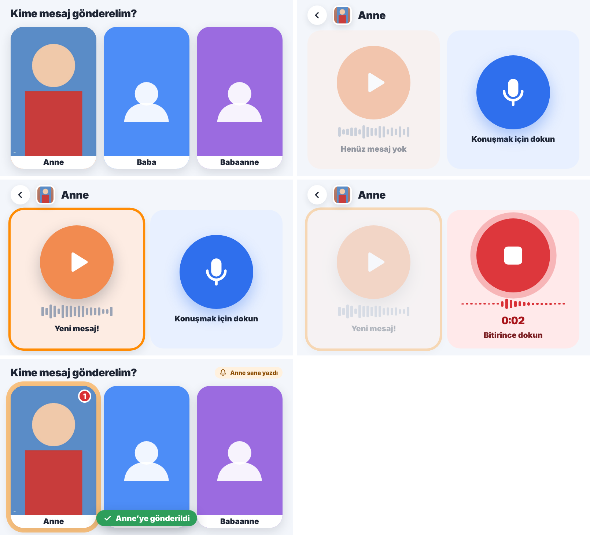

# Yazılım

Kutu, Raspberry Pi OS üzerinde çalışan tek bir Python sunucusu (`mesajkutusu/server.py`) ve bu sunucunun tam ekran açtığı bir web arayüzünden oluşur. Mesajlaşma **Telegram Bot API** üzerinden yapılır: hat, SIM ya da telefon gerekmez.



*Sol üst: ana ekran. Sağ üst: mesaj yokken kişi ekranı. Orta: yeni mesaj gelmiş (dinle düğmesi parlıyor). Sağ orta: kayıt. Alt: kayıt bitince ana ekrana dönüş.*

**Gerekenler:** SD kart okuyuculu bir Mac/PC, telefonunda Telegram, kutunun bağlanacağı Wi-Fi.

---

## 1. Telegram botunu oluştur

Telefonda, 5 dakika:

1. Telegram'da **@BotFather**'ı ara (mavi onay işaretli resmi hesap), **Başlat**'a dokun.
2. `/newbot` yaz.
3. Görünen ad sor: örn. `Ayşe'nin Kutusu`. Aile üyeleri bu adı görecek.
4. Kullanıcı adı sor: sonu `bot` ile bitmeli ve boşta olmalı, örn. `aysekutusu_bot`.
5. BotFather `123456789:AAH...` biçiminde bir **anahtar (token)** verir. Kopyala. Bu anahtar botun şifresidir, kimseyle paylaşma.
6. `/setjoingroups` → botunu seç → **Disable**. Bot gruplara eklenemez.
7. İstersen `/setuserpic` ile bota fotoğraf koy.

---

## 2. SD kartı yaz (Raspberry Pi Imager)

1. [Raspberry Pi Imager](https://www.raspberrypi.com/software/)'ı kur ve aç.
2. **Cihaz:** Raspberry Pi 5. **İşletim sistemi:** Raspberry Pi OS (64-bit), masaüstlü sürüm. **Depolama:** SD kart.
3. Özelleştirme ekranında **mutlaka** doldur:
   - Ana bilgisayar adı: `mesajkutusu`
   - Kullanıcı adı ve şifre (unutma, uzaktan bakımda lazım)
   - **Wi-Fi adı ve şifresi** (ilk açılıştaki kurulum internetten paket indirir)
   - Saat dilimi: Europe/Istanbul, klavye: tr
   - İstersen SSH'yi aç
4. Yaz. Bittiğinde kartı çıkarma; Mac'te `bootfs` adlı bir disk olarak görünür.

---

## 3. SD kartı kutu için hazırla

Bu adım uygulamayı kartın boot bölümüne kopyalar ve Pi ilk açıldığında kendini kuracak şekilde ayarlar. Mac, kartın Linux bölümüne yazamadığı için asıl kurulum Pi'nin ilk açılışında yapılır.

1. Bu depoyu indir: **Code › Download ZIP** ya da `git clone https://github.com/ekremcet/raspberrytime`.
2. Kart Mac'te takılıyken `yazilim/mesajkutusu/SD-KARTA-KUR.command` dosyasına çift tıkla.
   - macOS engellerse: sağ tık › **Aç**.
   - Ya da Terminal'de: `bash yazilim/mesajkutusu/sd-hazirla.sh /Volumes/bootfs`
   - Linux'ta: `bash yazilim/mesajkutusu/sd-hazirla.sh /media/$USER/bootfs`
3. Finder'da `bootfs › mesajkutusu › ayarlar.env` dosyasını TextEdit ile aç ve doldur:
   ```
   BOT_TOKEN=123456789:AAH...      # 1. adımdaki anahtar; boşluk ve tırnak yok
   YONETICI_PIN=4826               # yönetim sayfası için kendi seçtiğin rakamlar
   KUTU_ADI=Ayşe'nin Kutusu
   ```
   Diğer ayarlar için bkz. [10. Ayarlar](#10-ayarlar).
4. Kaydet. Finder'da `bootfs`'in yanındaki ⏏ ile kartı **güvenle çıkar**.

Betik, kartta Raspberry Pi OS'un hangi ilk açılış yöntemini kullandığını (cloud-init `user-data`, Imager `firstrun.sh` ya da hiçbiri) kendisi bulur. İki kez çalıştırmak zarar vermez.

---

## 4. Kartı tak ve aç

1. Kartı Pi'ye tak, gücü bağla.
2. Pi kendini birkaç kez yeniden başlatır (disk genişletme, kullanıcı ve Wi-Fi ayarları). Normaldir.
3. Masaüstü gelir. Arka planda kurulum başlar (5–10 dk), ekranda bir şey değişmez. Kurulum:
   - `python3-aiohttp`, `ffmpeg`, `chromium` paketlerini kurar,
   - uygulamayı `~/mesajkutusu` klasörüne kopyalar,
   - sunucuyu açılışta başlayan bir kullanıcı servisi yapar (`mesajkutusu.service`),
   - masaüstüne otomatik girişi ve tam ekran arayüzü açar, sistemin ekran karartmasını kapatır.
4. Pi bir kez daha yeniden başlar ve **"Kime mesaj gönderelim?"** ekranı açılır.

Kurulumun ilerlemesi kartın boot bölümündeki `mesajkutusu-kurulum.log` dosyasına yazılır. Bir sorun olursa kartı Mac'e takıp bu dosyaya bak. İnternet yoksa kurulum her 30 saniyede bir tekrar dener.

---

## 5. Ekran yönü

Kasada ekran ters durursa görüntü baş aşağı gelir. İki yol var:

**A. Masaüstünden (önerilen):**
1. Uzak kabukta ya da klavyeyle `pkill -f chromium` çalıştır; tam ekran arayüz kapanır.
2. Raspberry menüsü › **Preferences › Control Centre › Screens**.
3. **DSI-1**'e sağ tık › **Orientation › Inverted** › **Apply**. Varsa **Touchscreen** menüsünden dokunmatiği de DSI ekranına ata.
4. `sudo reboot`. Ayar kalıcıdır.

**B. Yönetim sayfasından:** **Ekran** sekmesinde **Ekran yönü**'nü **Ters (180°)** yap. Görüntü ve dokunmatik hemen döner, her açılışta da uygulanır. "Sistem ayarı" seçiliyken A yöntemindeki ayara dokunulmaz.

---

## 6. Ses

En kolayı: yönetim sayfası › **Ses** sekmesinden hoparlörü ve mikrofonu seç, seviyeleri ayarla, **Zili kutuda çal** ile dene.

Komut satırından da yapılabilir. Kutu varsayılan hoparlörü ve mikrofonu kullanır. Kontrol et:

```bash
wpctl status
```

`Sinks` altında USB hoparlör (örn. `UACDemoV1.0`), `Sources` altında BOYA (`UAC 1.0 Microphone`) **yıldızlı** olmalı. Değilse:

```bash
wpctl set-default <numara>                    # hoparlör ve mikrofon için ayrı ayrı
wpctl set-volume @DEFAULT_AUDIO_SINK@ 1.0     # hoparlör sesi %100 (çok yüksekse 0.7)
```

USB hoparlörlerin varsayılan seviyesi düşük (%40) olabilir; zil duyulmuyorsa ilk bakılacak yer burası.

---

## 7. Yönetim sayfası ve ilk kişi

1. Telefonu kutuyla **aynı Wi-Fi**'ye bağla, **http://mesajkutusu.local:8080/yonetim** adresini aç.
   - Açılmazsa Pi'de `hostname -I` ile IP'yi öğren: `http://IP:8080/yonetim`.
2. `ayarlar.env`'deki PIN ile gir. (PIN'i boş bıraktıysan rastgele üretildi: `cat ~/mesajkutusu/veri/yonetici_pin.txt`)
3. **Bot** bölümünde yeşil nokta ve **t.me/...** bağlantısı görünmeli. Bağlantıya dokun, Telegram açılınca **Başlat**'a bas.
4. Sayfayı yenile: **Onay bekleyenler**'de görünürsün. Kutuda görünecek adı yaz (Baba, Anne…) ve **Onayla**.
5. Fotoğraf kutusuna dokunup fotoğraf seç. Fotoğraf kırpılmaz, kutucuğa tamamı sığacak şekilde yerleşir. Renk ve sırayı da buradan ayarla.
6. **Deneme mesajı** ile zili ve ekranı dene.
7. Telegram'dan bota bir sesli mesaj gönder (mikrofon tuşuna basılı tut). Kutuda zil çalar, kutucuğun parlar.
8. Kutuda kutucuğuna dokun, **mikrofon**'a dokun, konuş, **kare** düğmeye dokun. Mesaj hemen gider ve Telegram'ına sesli not olarak düşer.

---

## 8. Aileyi ekle

1. Yönetim sayfasındaki **t.me/...** bağlantısını aile üyelerine gönder.
2. Her biri bağlantıyı açıp **Başlat**'a dokunur. Bot onlara "onay bekleniyor" der.
3. Yönetim sayfasında **Onayla**, ad ve fotoğraf ver.

Telegram kuralı gereği bot, kendisine hiç yazmamış birine mesaj gönderemez; bu yüzden herkesin bir kez **Başlat**'a dokunması şarttır. Onaylamadığın kişilerin mesajları yok sayılır.

Aile üyeleri için kullanım: bota normal Telegram sesli mesajı gönderirler. Çocuğun mesajları aynı sohbete sesli not olarak düşer. Çocuk bir mesajı dinleyince gönderenin Telegram'ında o mesaja 👀 tepkisi çıkar.

Sesli mesaj dışında bir şey (yazı, fotoğraf, çıkartma, video) gönderilirse bot hemen "⚠️ Bunu *çocuğun adı* göremez, yalnızca sesli mesajları görebilir" diye yanıt verir. Çocuğun adını yönetim sayfasının **Genel** sekmesinden yaz.

---

## 9. Uzaktan erişim ve güncelleme

### Raspberry Pi Connect

Raspberry Pi OS'ta hazır gelir. Pi'de görev çubuğundaki **Connect** simgesinden (ya da `rpi-connect signin`) Raspberry Pi hesabınla eşleştir. Sonra [connect.raspberrypi.com](https://connect.raspberrypi.com) üzerinden:
- **Remote shell:** komut satırı (güncelleme, günlükler, ayarlar)
- **Screen sharing:** ekranı görmek ve masaüstü ayarları

### İlk kez: depoyu Pi'ye al

Uzak kabukta bir kez:

```bash
git clone https://github.com/ekremcet/raspberrytime ~/raspberrytime
bash ~/raspberrytime/yazilim/guncelle.sh
```

### Her güncellemede

```bash
bash ~/raspberrytime/yazilim/guncelle.sh
```

Betik:
1. GitHub'dan son sürümü çeker (`git pull`),
2. dosyaları `~/mesajkutusu`'ya kopyalar; **`veri/` (kişiler, mesajlar, fotoğraflar) ve `ayarlar.env`'e dokunmaz**,
3. yeni eklenen ayarları varsayılan değerleriyle `ayarlar.env`'e ekler,
4. servisi yeniden başlatır ve ekrandaki arayüzü yeniden açar.

### Yönetim sayfasından güncelleme

Depo Pi'ye bir kez alındıktan sonra (yukarıdaki `git clone`), yönetim sayfasının **Sistem** sekmesinde **Güncellemeleri denetle** → **Güncelle** ile uzak kabuğa girmeden de güncelleyebilirsin. Kutu yaklaşık bir dakika içinde yeni sürümle açılır.

---

## 10. Ayarlar

Kurulumdan sonra **bütün ayarlar yönetim sayfasından** değiştirilir ve hemen geçerli olur; her kayıttan sonra altta yeşil **Kaydedildi** yazısı çıkar. Ayarlar cihazdaki veritabanında saklanır.

| Sekme | Ayarlar |
|---|---|
| **Kişiler** | Bot durumu ve davet bağlantısı, onay bekleyenler, kişi adı, fotoğraf, renk, sıra, deneme mesajı, kaldır/engelle |
| **Ses** | Hoparlör ve mikrofon seçimi, ses seviyesi, mikrofon seviyesi, **Zili kutuda çal** (deneme), zil açık/kapalı, zil yüksekliği, dinlenmemiş mesaj hatırlatma aralığı |
| **Ekran** | Gündüz ve gece parlaklığı, kararma süresi (varsayılan 2 dk), kararınca saat gösterme, gece koyu teması, ekran yönü (dokunmatik de birlikte döner) |
| **Sessiz / Gece** | Şimdi sessiz moda al / kapat, her gece otomatik sessiz (varsayılan 19:30–07:30), gece gönderene "sabah görülecek" notu |
| **Genel** | Kutunun adı, çocuğun adı (bot uyarılarında), dil (Türkçe/English: kutu ekranı + bot mesajları), en uzun kayıt, saklanan mesaj sayısı, 👀 dinlendi tepkisi, çocuk ekranına ağdan erişim, **yönetici PIN'i**, **bot anahtarı** |
| **Sistem** | Cihaz bilgisi (sürüm, IP, sıcaklık, disk, bellek), **güncellemeleri denetle ve kur**, uygulamayı / cihazı yeniden başlat, kapat |

**Bir kerelik izin:** Parlaklık ve "Cihazı yeniden başlat / kapat" düğmeleri için Pi'de uzak kabuktan bir kez `bash ~/raspberrytime/yazilim/guncelle.sh` çalıştırıp şifreni gir. Betik yalnızca bu iki işlem için izin ekler (`/etc/sudoers.d/mesajkutusu` ve arka ışık için bir udev kuralı).

`~/mesajkutusu/ayarlar.env` artık yalnızca başlangıç değerleri içindir (`BOT_TOKEN`, `YONETICI_PIN`, `KUTU_ADI`, `PORT`). Yönetim sayfasında değiştirilen değer dosyadakinin önüne geçer.

---

## 11. Çocuk ekranı nasıl çalışır

- **Ana ekran:** onaylı kişilerin fotoğrafları. Yeni mesajı olan kişinin kutucuğu turuncu parlar ve üstünde sayı rozeti çıkar; üstte "Anne sana yazdı" yazar.
- **Kişi ekranı:** iki büyük düğme.
  - Solda **dinle**: dinlenmemiş mesaj varsa (örn. "3 yeni mesaj!") **hepsini eskiden yeniye sırayla** çalar ("Dinliyorsun… 2/3"); hepsi dinlendiyse yalnızca **son** mesajı çalar. Yeni mesaj varken kart parlar.
  - Sağda **mikrofon**: dokun, konuş, kareye dokun. Mesaj hemen gönderilir ve ana ekrana dönülür; altta "Anne'ye gönderildi" yazar.
- **Zil:** yeni mesaj gelince üç notalı zil çalar, ekran uyuyorsa uyanır. Dinlenmemiş mesaj varsa ayarlanan aralıkta (varsayılan 10 dk) hafif bir zil tekrar çalar. Zil ve yüksekliği **Ses** sekmesinden.
- **Ekran kararması:** varsayılan 2 dakika dokunulmazsa ekran kararır ve büyük, 24 saatlik bir **saat** ile tarih gösterir (iz kalmasın diye saat her dakika hafifçe yer değiştirir). Dokununca uyanır. Kişi ekranında en geç 2 dakika sonra ana ekrana dönülür.
- **Sessiz mod:** zil ve hatırlatma çalmaz, yeni mesaj ekranı uyandırmaz. Mesajlar yine gelir; kutucuklar parlar, rozetler görünür, çocuk ekrana dokununca görür.
- **Gece (varsayılan 19:30–07:30):** otomatik sessiz mod + ekran koyu ve kısık renklere geçer; karardığında saat sıcak, kısık bir renkte ve ay simgesiyle görünür.
- **İnternet giderse:** üstte "İnternet yok, mesajlar sonra gidecek" yazar; giden mesajlar saklanır ve bağlantı gelince gönderilir.

---

## 12. Sorun giderme

Günlüğü görmek (uzak kabukta):

```bash
sudo journalctl _SYSTEMD_USER_UNIT=mesajkutusu.service -n 30 --no-pager
```

| Belirti | Sebep ve çözüm |
|---|---|
| Ekranda **"İnternet yok"**, ama Pi internette | Günlüğe bak. `Conflict` yazıyorsa aynı bot başka bir yerde de çalışıyor (örn. Mac'te deneme sunucusu açık kalmış): onu kapat. `Unauthorized` / `Not Found` ise anahtar hatalı (ekranda "Bot anahtarı hatalı" yazar). |
| Yönetim sayfasında kırmızı nokta | Sunucu yeni başladıysa ilk bağlantı birkaç saniye sürer. Kalıcıysa yukarıdaki gibi günlüğe bak. |
| Görüntü ters | [5. Ekran yönü](#5-ekran-yönü) |
| Dokunuşlar ters yere düşüyor | Ekran döndürülmüş ama dokunmatik bağlanmamış: 5B'deki komutu çalıştır ya da Screens › Touchscreen'den DSI'ya ata |
| Zil / ses duyulmuyor | Yönetim › **Sessiz / Gece**: sessiz mod ya da gece açık mı? Yönetim › **Ses**: doğru hoparlör seçili mi, seviye kaç? **Zili kutuda çal** ile dene. |
| Parlaklık ya da "Cihazı yeniden başlat" çalışmıyor | Bir kerelik izin gerekli: uzak kabukta `bash ~/raspberrytime/yazilim/guncelle.sh` çalıştırıp şifreni gir. |
| "Mikrofon bulunamadı" | `wpctl status`'ta BOYA `Sources` altında görünüyor mu? USB uzatmayı çıkarıp tak. |
| Yönetim sayfası açılmıyor | Telefon aynı Wi-Fi'de mi? `mesajkutusu.local` yerine IP dene (`hostname -I`). |
| İlk kurulum bitmedi | Kartı Mac'e tak, `bootfs/mesajkutusu-kurulum.log`'a bak. "İnternet yok" ise Wi-Fi bilgileri eksik. |
| Sunucu hiç çalışmıyor | `systemctl --user status mesajkutusu` |

---

## 13. Geliştirme

### Bilgisayarda denemek (demo modu)

```bash
brew install ffmpeg                # Linux: sudo apt install ffmpeg
pip3 install aiohttp
cd yazilim/mesajkutusu
python3 server.py
```

- Çocuk ekranı: http://localhost:8080 (Chrome önerilir)
- Yönetim: http://localhost:8080/yonetim (PIN terminale yazılır)

`BOT_TOKEN` boşsa örnek kişilerle **demo modunda** açılır. Gerçek bot ile denerken Pi'deki sunucuyu durdur: aynı bot aynı anda yalnızca tek yerden dinlenebilir.

### Dosyalar

```
yazilim/
├── guncelle.sh                      Pi'de: git pull + kurulum (veri ve ayarlar korunur)
└── mesajkutusu/
    ├── server.py                    sunucu: Telegram köprüsü, ses dönüştürme, API, WebSocket
    ├── static/index.html            çocuk ekranı
    ├── static/yonetim.html          yönetim sayfası
    ├── ayarlar.env.ornek            ayar şablonu
    ├── sd-hazirla.sh                SD kartı Mac/Linux'ta hazırlar
    ├── SD-KARTA-KUR.command         macOS için çift tıklanan sarmalayıcı
    ├── kur.sh                       elle kurulum (SSH ile, Pi'de)
    └── sistem/
        ├── ilk-kurulum.sh           ilk açılışta root olarak bir kez çalışır
        ├── mesajkutusu-kurulum.service
        ├── mesajkutusu.service      sunucu (kullanıcı servisi)
        └── kiosk.sh                 tam ekran Chromium + ekran yönü
```

### API

| Yol | Ne |
|---|---|
| `GET /` | Çocuk ekranı (yalnızca cihazın kendisinden; `UZAKTAN_ARAYUZ=1` ile ağdan da) |
| `GET /api/durum` | Kişiler, okunmamış sayıları, bağlantı durumu, ayarlar |
| `GET /api/mesajlar/{kisi}` | Kişinin son mesajları |
| `POST /api/gonder?kisi=` | Kayıt yükle (webm/ogg/mp4), Opus'a çevrilip Telegram'a gider |
| `POST /api/dinlendi/{mesaj}` | Dinlendi işaretle (gönderene 👀 tepkisi) |
| `GET /ws` | Canlı olaylar: yeni mesaj, bağlantı, kişi değişikliği |
| `GET /yonetim` | Yönetim sayfası |
| `/api/yonetim/...` | `X-Yonetici-Pin` başlığı ile: bilgi, kişiler, onay/güncelle, fotoğraf, sıra, sil, deneme |
| `GET/POST /api/yonetim/ayarlar` | Tüm ayarlar (dil, zil, ekran, sessiz/gece, mesajlaşma); veritabanında saklanır |
| `GET/POST /api/yonetim/ses` | Hoparlör/mikrofon seçimi ve seviyeleri (PipeWire `wpctl`) |
| `POST /api/yonetim/zil` | Kutuda zili çal (deneme) |
| `GET/POST /api/yonetim/ekran` | Parlaklık durumu, ekran yönünü uygula |
| `GET/POST /api/yonetim/guvenlik` | PIN ve bot anahtarı |
| `GET/POST /api/yonetim/sistem` | Cihaz bilgisi, güncelleme, yeniden başlatma, kapatma |
| `POST /api/ekran` | Çocuk ekranı uykuya geçti/uyandı (arka ışık) |

### Elle kurulum (SD kart yöntemi yerine)

SSH açık bir Pi'de:

```bash
git clone https://github.com/ekremcet/raspberrytime ~/raspberrytime
cp -r ~/raspberrytime/yazilim/mesajkutusu ~/mesajkutusu
cd ~/mesajkutusu && bash kur.sh
nano ayarlar.env                     # BOT_TOKEN ve YONETICI_PIN
systemctl --user restart mesajkutusu
sudo reboot
```
