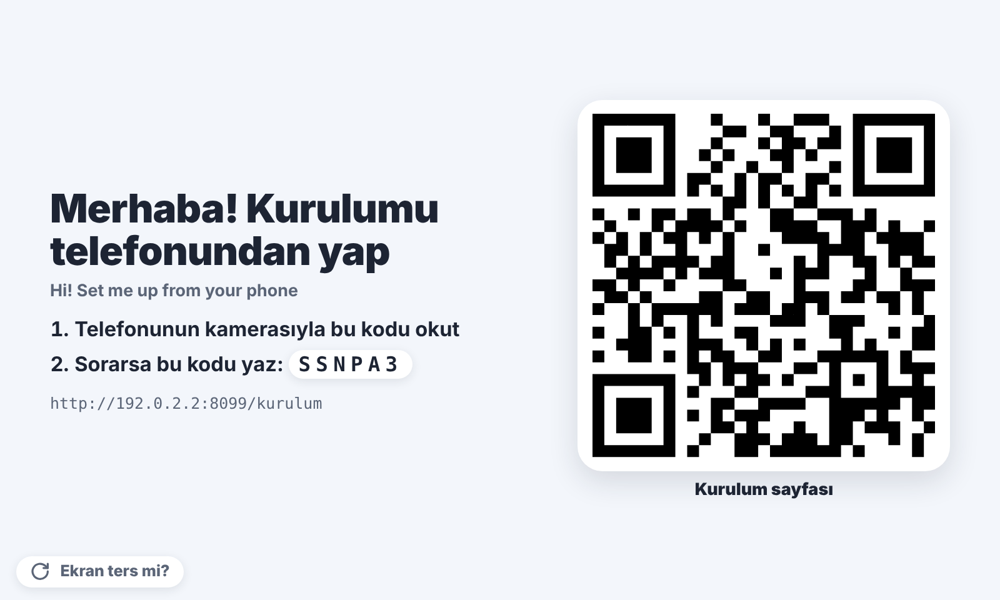
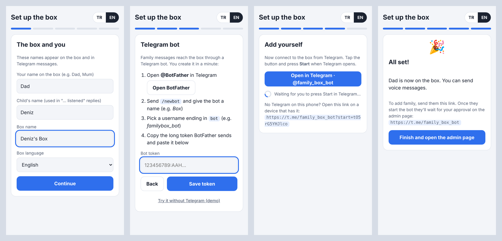

# Software

The box is a single Python server (`mesajkutusu/server.py`) running on Raspberry Pi OS, plus a web interface that the server opens full screen. Messaging goes through the **Telegram Bot API**: no phone line, SIM or phone needed.


*Top left: home screen. Top right: person screen with no messages. Middle: a new message has arrived (the listen button glows). Middle right: recording. Bottom: back to the home screen after sending.*

> The device interface and the admin page are in Turkish by default. The child's screen and the bot messages can be switched to English on the admin page (**Genel › Dil**). Admin page labels are given below as they appear, with an English translation.

**You need:** a Mac/PC with an SD card reader, a phone with Telegram, and your home Wi-Fi password. No typing on the Pi and no config files: the box shows a QR code and the rest happens on your phone.

---

## 1. Prepare the SD card

Pick one of the two ways.

### A. Ready-made image (easiest)

1. Download the latest `mesajkutusu-*.img.xz` from the repository's [**Releases**](https://github.com/ekremcet/raspberrytime/releases) page.
2. Open [Raspberry Pi Imager](https://www.raspberrypi.com/software/) → **Device:** Raspberry Pi 4 or 5 → **Operating system:** scroll down to **Use custom** and pick the downloaded file → **Storage:** the SD card.
3. When Imager offers OS customisation, choose **No**. The image already has everything (user `kutu`, hostname `mesajkutusu`, packages, the app). Write the card.

The image is Raspberry Pi OS (64-bit, desktop) with the app preinstalled, built by the [`SD card image`](../.github/workflows/imaj.yml) workflow. It is set up for Turkey (Wi-Fi country `TR`, Turkish locale, Istanbul time zone); build your own with other values from the **Actions** tab (see [13. Development](#13-development)).

### B. Official Raspberry Pi OS + the setup script

Use this if there's no release yet or you want the stock OS.

1. In Raspberry Pi Imager: **Device:** Raspberry Pi 4/5. **Operating system:** Raspberry Pi OS (64-bit), the desktop version. In the customisation screen fill in hostname `mesajkutusu`, a username and password, **your Wi-Fi** (the first boot downloads packages), time zone and keyboard. Write the card and leave it in the Mac; it appears as a disk called `bootfs`.
2. Download this repository (**Code › Download ZIP**, or `git clone https://github.com/ekremcet/raspberrytime`).
3. With the card in the Mac, double-click `yazilim/mesajkutusu/SD-KARTA-KUR.command`.
   - If macOS blocks it: right-click › **Open**. Or in Terminal: `bash yazilim/mesajkutusu/sd-hazirla.sh /Volumes/bootfs`
   - On Linux: `bash yazilim/mesajkutusu/sd-hazirla.sh /media/$USER/bootfs`
4. Eject the card (⏏ next to `bootfs` in Finder).

The script copies the app to the card's boot partition and hooks a one-time installer into the first boot (it detects cloud-init `user-data`, Imager's `firstrun.sh`, or neither). Running it twice does no harm. You no longer need to edit `ayarlar.env`; the bot token and PIN are entered on your phone in step 3.

---

## 2. Insert the card and power on

1. Insert the card into the Pi and connect power.
2. **Image (A):** after one or two automatic restarts (the card expands itself) the setup screen appears, usually within 2 minutes.
3. **Script (B):** the Pi restarts a few times, the desktop appears, and the installer runs in the background for 5–10 minutes (it installs `python3-aiohttp`, `ffmpeg`, `chromium`, copies the app to `~/mesajkutusu`, sets up the services, turns on automatic login and the full-screen interface). Then it restarts once more. Progress is written to `mesajkutusu-kurulum.log` on the card's boot partition; without internet it retries every 30 seconds.

When it's ready the box shows **"Merhaba! Kurulumu telefonundan yap"** (Hi! Set me up from your phone) with a QR code and a 6-character code.

If the picture is upside down, tap **Ekran ters mi?** (Screen upside down?) in the bottom-left corner; the picture and touch rotate together.

---

## 3. Set up from your phone



**If the box couldn't get online** (new image, no Wi-Fi yet), after about a minute it opens its own Wi-Fi network called `MesajKutusu-XXXX` and shows two QR codes: **1** joins that network (the password is printed under it), **2** opens the setup page. Pick your home Wi-Fi on the page and type its password. The box switches to your network, the phone drops off the box's network (expected), and a new QR code appears on the box: reconnect the phone to your home Wi-Fi and scan it to carry on. If the password was wrong, the box reopens its own network and says so.

**If the box is online**, scan the single QR code with the phone's camera. The phone must be on the same Wi-Fi. If it asks for a code, type the one on the screen.

The setup page walks through five steps (Turkish or English, switch with the TR/EN button):

| Step | What you do |
|---|---|
| **The box and you** | Your name as shown on the box (Dad, Mom…), the child's name, the box name, the box language |
| **Admin PIN** | 4–12 digits; needed later to approve people and change settings |
| **Telegram bot** | Open **@BotFather** (button on the page), send `/newbot`, give it a name and a username ending in `bot`, copy the token BotFather sends and paste it. The page checks it with Telegram before saving. |
| **Add yourself** | Tap **Open in Telegram** and press **Start**. You are approved automatically and your tile appears on the box. |
| **Done** | The page shows the bot link to send to family and opens the admin page, already logged in. |



Optional, in BotFather: `/setjoingroups` → your bot → **Disable** (the bot ignores groups anyway), and `/setuserpic` for a bot photo. The token is the bot's password; don't share it.

> Want to try it without Telegram first? On the bot step, tap **Try it without Telegram (demo)**. The box starts with sample contacts; add a token later on the admin page (**Genel › Bot anahtarı**).

---

## 4. Screen orientation

Besides the **Ekran ters mi?** button on the setup screen, the admin page's **Ekran** (Screen) tab has **Ekran yönü** (Screen orientation): **Ters (180°)** (Inverted) rotates the picture and touch immediately and at every boot. "Sistem ayarı" (System setting) leaves the desktop's own setting alone.

---

## 5. Audio

The box picks the **USB speaker and USB microphone automatically** (checked every 30 seconds, so a device plugged in later is picked up too). On the admin page's **Ses** (Sound) tab you can adjust the levels and test with **Zili kutuda çal** (Ring the chime on the box). Choosing a device by hand there turns the automatic choice off; tick **USB hoparlör ve mikrofonu otomatik seç** to turn it back on.

USB speakers may start at a low level (40%); if you can't hear the chime, raise **Ses seviyesi** first. From the command line: `wpctl status` lists the devices (the default has an asterisk), `wpctl set-default <id>` and `wpctl set-volume @DEFAULT_AUDIO_SINK@ 1.0` change them.

---

## 6. Admin page

Open **http://mesajkutusu.local:8080/yonetim** on a phone or computer on the same Wi-Fi (if `.local` doesn't resolve, use the IP shown under the QR during setup or on the **Sistem** tab). Log in with your PIN. Things to try first:

1. Tap the photo box of your tile and pick a photo. It isn't cropped; it's fitted whole into the tile. Set the color and order here too.
2. **Deneme mesajı** (Test message) checks the chime and the screen.
3. Send a voice message to the bot from Telegram. The box chimes and your tile glows.
4. On the box: tap your tile, tap the **microphone**, talk, tap the **square**. The message arrives in your Telegram as a voice note.

Forgot the PIN? In the remote shell, this drops the PIN you chose and falls back to the one generated at first start, which it then prints:

```bash
python3 -c "import sqlite3,os; c=sqlite3.connect(os.path.expanduser('~/mesajkutusu/veri/kutu.db')); c.execute(\"DELETE FROM meta WHERE k='gizli_pin'\"); c.commit()"
systemctl --user restart mesajkutusu && cat ~/mesajkutusu/veri/yonetici_pin.txt
```

---

## 7. Add the family

1. Send the **t.me/...** link (on the last wizard step, and in the **Bot** section of the admin page) to your family.
2. Each of them opens it and taps **Start**. The bot tells them they're waiting for approval.
3. On the admin page, press **Onayla** (Approve) and give them a name and photo.

Telegram doesn't let a bot message someone who has never written to it, so everyone taps **Start** once. Messages from people you haven't approved are ignored.

How family members use it: they send the bot ordinary Telegram voice messages. The child's messages arrive in the same chat as voice notes. When the child listens to a message, a 👀 reaction appears on it in the sender's Telegram. If anything other than a voice message is sent (text, photo, sticker, video), the bot replies "⚠️ *Child's name* can't see this, only voice messages".

---

## 8. Wi-Fi

- **Change network** (moving house, new router): admin page › **Sistem** › **Wi-Fi**: pick the network, type the password, **Bu ağa bağlan** (Connect). If it can't connect, the box goes back to the old network.
- **Box can't reach any known network** (router off, password changed): after about a minute it opens its `MesajKutusu-XXXX` network and the screen shows "Wi-Fi'ye bağlanamadım" (I can't reach the Wi-Fi) with the two QR codes; the second one opens the admin page, where you pick the new network. While nobody is connected to it, the box retries the known networks every 4 minutes, so it comes back by itself when the router returns.

---

## 9. Remote access and updates

### Raspberry Pi Connect

Comes with Raspberry Pi OS. Pair the Pi with your Raspberry Pi account via the **Connect** icon in the taskbar (or `rpi-connect signin`). Then, at [connect.raspberrypi.com](https://connect.raspberrypi.com):
- **Remote shell:** a command line (updates, logs, settings)
- **Screen sharing:** see the screen and change desktop settings

### Update from the admin page (easiest)

**Sistem** (System) tab › **Güncellemeleri denetle** (Check for updates) → **Güncelle** (Update). The first check downloads the source code to `~/raspberrytime` by itself. The box comes back with the new version within about a minute.

### Update from the remote shell

```bash
bash ~/raspberrytime/yazilim/guncelle.sh
```

The script:
1. pulls the latest version from GitHub (`git pull`) and continues with the new copy of itself,
2. copies the files to `~/mesajkutusu`; **it doesn't touch `veri/` (contacts, messages, photos) or `ayarlar.env`**,
3. adds any newly introduced settings to `ayarlar.env` with their default values,
4. restarts the service and reopens the interface on the screen.

If `~/raspberrytime` doesn't exist yet: `git clone https://github.com/ekremcet/raspberrytime ~/raspberrytime` first.

> **Boxes installed before the setup wizard existed:** run `bash ~/raspberrytime/yazilim/guncelle.sh` once from the remote shell (not the admin page) and enter your password when asked. That installs the Wi-Fi helper (`mesajkutusu-wifi.service`) along with the restart and brightness permissions. Your contacts, token and PIN stay as they are; the box doesn't go into setup mode.

---

## 10. Settings

After installation, **all settings are changed from the admin page** and take effect immediately; a green **Kaydedildi** (Saved) note appears at the bottom after every save. Settings are stored in the database on the device.

| Tab | Settings |
|---|---|
| **Kişiler** (People) | Bot status and invite link, people waiting for approval, contact name, photo, color, order, test message, remove/block |
| **Ses** (Sound) | Automatic USB speaker/microphone choice, speaker and microphone selection, volume, microphone level, **Zili kutuda çal** (ring the chime on the box), chime on/off, chime volume, reminder interval for unheard messages |
| **Ekran** (Screen) | Day and night brightness, sleep timeout (default 2 min), show clock while sleeping, dark night theme, screen orientation (touch rotates along) |
| **Sessiz / Gece** (Quiet / Night) | Turn quiet mode on/off now, automatic quiet mode every night (default 19:30–07:30), "will be seen in the morning" note to senders at night |
| **Genel** (General) | Box name, child's name (used in bot warnings), language (Turkish/English: box screen + bot messages), maximum recording length, number of stored messages, 👀 listened reaction, network access to the child screen, **admin PIN**, **bot token** |
| **Sistem** (System) | Device info (version, IP, temperature, disk, memory), **Wi-Fi network**, **check for and install updates**, restart the app / device, shut down |

The installer (image or script) grants the box what these buttons need: `/etc/sudoers.d/mesajkutusu` (restart / shut down only), a udev rule for the backlight, and the root `mesajkutusu-wifi.service` that manages Wi-Fi through NetworkManager.

`~/mesajkutusu/ayarlar.env` is optional and only holds starting values (`BOT_TOKEN`, `YONETICI_PIN`, `KUTU_ADI`, `PORT`). Values from the setup wizard or the admin page take precedence. A box with `BOT_TOKEN` filled in skips the setup wizard.

---

## 11. How the child's screen works

- **Home screen:** no text; the whole screen is contact photos (the name sits small at the bottom of the photo). At most 3×3 = 9 people per page; more go to the next pages, which you browse by swiping or with the side arrows, with page dots at the bottom. A contact with a new message glows orange with a count badge, their page dot turns orange, and the screen switches to that page by itself.
- **Person screen:** two big buttons.
  - Left, **listen**: if there are unheard messages (e.g. "3 new messages!") it plays **all of them in order, oldest first** ("Listening… 2/3"); once all are heard, it plays only the **last** message. The card glows while there are new messages.
  - Right, **microphone**: tap, talk, tap the square. The message is sent immediately and the screen returns home, showing "Sent to Mom" at the bottom.
- **Chime:** a three-note chime plays when a new message arrives, waking the screen if it's asleep. While there are unheard messages, a soft chime repeats at the set interval (default 10 min). Chime and volume are on the **Ses** (Sound) tab.
- **Sleep:** after 2 minutes without touch (default) the screen dims and shows a large 24-hour **clock** and the date (the clock shifts slightly every minute to avoid burn-in). Touch wakes it; the waking touch only turns the screen on and is not treated as a press on the contact or button underneath. On the person screen, the box returns home after at most 2 minutes.
- **Quiet mode:** no chime or reminder, and new messages don't wake the screen. Messages still arrive; tiles glow and badges show, and the child sees them on the next touch.
- **Night (default 19:30–07:30):** automatic quiet mode, and the screen switches to dark, dimmed colors; when sleeping, the clock shows in a warm, dim color with a moon icon.
- **If the internet drops:** "İnternet yok, mesajlar sonra gidecek" (No internet, messages will be sent later) appears at the top; outgoing messages are kept and sent when the connection returns.

---

## 12. Troubleshooting

To see the log (in the remote shell):

```bash
sudo journalctl _SYSTEMD_USER_UNIT=mesajkutusu.service -n 30 --no-pager
```

| Symptom | Cause and fix |
|---|---|
| Setup QR doesn't open on the phone | The phone must be on the same network as the box (your home Wi-Fi, or the box's `MesajKutusu-XXXX` network). Some phones leave a network without internet; if so, turn off mobile data while setting up. |
| Box shows "Wi-Fi'ye bağlanamadım" after I picked my network | The password was wrong, or the network is 5 GHz-only on an old router: try again on the setup page. |
| **"İnternet yok"** (No internet) on screen, but the Pi is online | Check the log. `Conflict` means the same bot is running somewhere else too (e.g. a test server left running on a Mac): stop it. `Unauthorized` / `Not Found` means the token is wrong (the screen shows "Bot anahtarı hatalı" / bot key is wrong). |
| Red dot on the admin page | Right after the server starts, the first connection takes a few seconds. If it persists, check the log as above. |
| Picture upside down | Tap **Ekran ters mi?** on the setup screen, or [4. Screen orientation](#4-screen-orientation) |
| Touches land in the wrong place | The screen was rotated but touch wasn't mapped to it: set the orientation from the admin page (section 4) so touch rotates with the picture |
| Can't hear the chime / sound | Admin › **Sessiz / Gece**: is quiet mode or night mode on? Admin › **Ses**: is the right speaker selected, what's the level? Test with **Zili kutuda çal**. |
| Brightness, "Restart device" or the Wi-Fi card doesn't work | Older install: run `bash ~/raspberrytime/yazilim/guncelle.sh` once in the remote shell and enter your password. |
| "Mikrofon bulunamadı" (Microphone not found) | Does the BOYA appear under `Sources` in `wpctl status`? Unplug and replug the USB extension. |
| Admin page won't open | Is the phone on the same Wi-Fi? Try the IP instead of `mesajkutusu.local` (`hostname -I`). |
| First installation didn't finish (script method) | Put the card in the Mac and read `bootfs/mesajkutusu-kurulum.log`. "İnternet yok" means the Wi-Fi details are missing. |
| Wi-Fi helper log | `sudo journalctl -u mesajkutusu-wifi -n 30 --no-pager` |
| Screen goes dark now and then, or doesn't turn on | Most likely the display power wires (pin 4/6) or a ribbon cable is loose: [hardware › 3.9 Cable management](../donanim/README.md#39-cable-management) |
| Microphone drops out now and then | The joint between the microphone and the USB extension is loose: tape it ([hardware › 3.9](../donanim/README.md#39-cable-management)) |
| Server doesn't run at all | `systemctl --user status mesajkutusu` |

---

## 13. Development

### Try it on a computer (demo mode)

```bash
brew install ffmpeg                # Linux: sudo apt install ffmpeg
pip3 install aiohttp
cd yazilim/mesajkutusu
python3 server.py
```

- Child screen: http://localhost:8080 (Chrome recommended)
- Admin: http://localhost:8080/yonetim (the PIN is printed in the terminal)

With an empty `BOT_TOKEN` it starts in **setup mode**: the child screen shows the QR code and http://localhost:8080/kurulum runs the wizard (the code is printed in the terminal). For **demo mode** with sample contacts and no Telegram: `DEMO=1 python3 server.py`. When testing with the real bot, stop the server on the Pi: a bot can only be polled from one place at a time.

### Build the SD card image

The [`SD card image`](../.github/workflows/imaj.yml) workflow builds Raspberry Pi OS (64-bit, desktop) with [pi-gen](https://github.com/RPi-Distro/pi-gen) through [`usimd/pi-gen-action`](https://github.com/usimd/pi-gen-action), adding the custom stage in [`imaj/stage-mesajkutusu`](../imaj/stage-mesajkutusu). The stage runs `sistem/ilk-kurulum.sh` inside the image with `MESAJKUTUSU_IMAJ=1`, the same installer the SD-card method runs on first boot.

- **Release:** push a tag such as `v1.0`; the image (`.img.xz`, about 1.5 GB) is attached to the GitHub release.
- **Test build:** Actions › **SD card image** › **Run workflow**; set the Wi-Fi country, locale and time zone. The image is downloadable from the run page for 14 days.
- A build takes about 1–2 hours on GitHub's free runners. The image user is `kutu` (password `mesajkutusu`, SSH off); change the password from the remote shell with `passwd` if you turn SSH on.

### Files

```
yazilim/
├── guncelle.sh                      on the Pi: git pull + install (data and settings kept)
└── mesajkutusu/
    ├── server.py                    server: Telegram bridge, audio conversion, setup wizard API, WebSocket
    ├── static/index.html            child screen (+ setup QR screen)
    ├── static/kurulum.html          setup wizard (phone)
    ├── static/yonetim.html          admin page
    ├── static/vendor/qrcode.js      QR code generator (MIT, Kazuhiko Arase)
    ├── ayarlar.env.ornek            settings template
    ├── sd-hazirla.sh                prepares the SD card on Mac/Linux
    ├── SD-KARTA-KUR.command         double-click wrapper for macOS
    ├── kur.sh                       manual installation (over SSH, on the Pi)
    └── sistem/
        ├── ilk-kurulum.sh           installer: first boot (SD method) or inside the image build
        ├── mesajkutusu-kurulum.service
        ├── mesajkutusu.service      the server (user service)
        ├── wifi-yardimci.py         Wi-Fi helper (root): fallback network, connect requests
        ├── mesajkutusu-wifi.service
        └── kiosk.sh                 full-screen Chromium + screen orientation
```

### API

| Path | Purpose |
|---|---|
| `GET /` | Child screen (only from the device itself, or from the network if enabled on the admin page) |
| `GET /api/durum` | Contacts, unread counts, connection state, settings |
| `GET /api/mesajlar/{kisi}` | A contact's recent messages |
| `POST /api/gonder?kisi=` | Upload a recording (webm/ogg/mp4); converted to Opus and sent to Telegram |
| `POST /api/dinlendi/{mesaj}` | Mark as listened (👀 reaction to the sender) |
| `GET /ws` | Live events: new message, connection, contact changes |
| `GET /yonetim` | Admin page |
| `/api/yonetim/...` | With the `X-Yonetici-Pin` header: info, contacts, approve/update, photo, order, delete, test |
| `GET/POST /api/yonetim/ayarlar` | All settings (language, chime, screen, quiet/night, messaging); stored in the database |
| `GET/POST /api/yonetim/ses` | Speaker/microphone selection and levels (PipeWire `wpctl`) |
| `POST /api/yonetim/zil` | Ring the chime on the box (test) |
| `GET/POST /api/yonetim/ekran` | Brightness state, apply screen orientation |
| `GET/POST /api/yonetim/guvenlik` | PIN and bot token |
| `GET/POST /api/yonetim/sistem` | Device info, update, restart, shut down |
| `POST /api/ekran` | Child screen went to sleep / woke up (backlight) |
| `GET /api/yonetim/wifi` | Wi-Fi state and nearby networks |
| `GET /kurulum` | Setup wizard (only until setup is finished) |
| `/api/kurulum/...` | With the `X-Kurulum-Kodu` header (the code on the box screen): `durum`, `genel`, `pin`, `token`, `davet` via Telegram `/start <invite>`, `wifi`, `demo`, `bitir`. All return 403 once setup is finished; `wifi` then needs the admin PIN instead. |

### Manual installation (instead of the SD card method)

On a Pi with SSH enabled:

```bash
git clone https://github.com/ekremcet/raspberrytime ~/raspberrytime
cp -r ~/raspberrytime/yazilim/mesajkutusu ~/mesajkutusu
cd ~/mesajkutusu && bash kur.sh
sudo reboot                          # then scan the QR code on the screen
```
